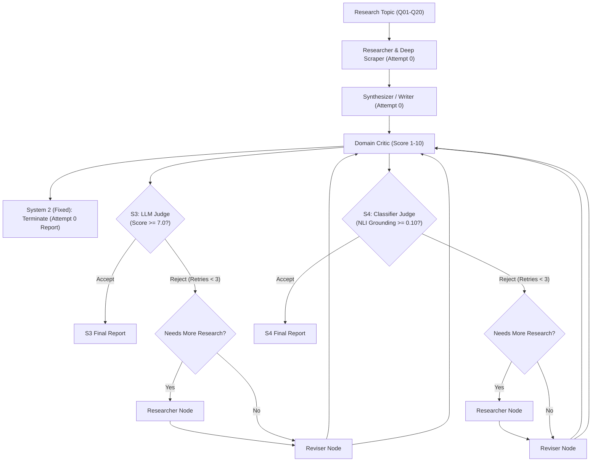
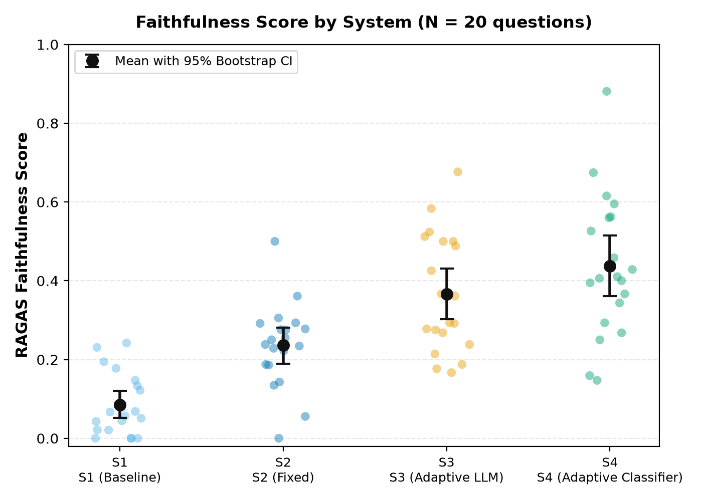

# Fixed vs. Adaptive: Self-Correcting Multi-Agent AI Pipelines

This repository contains the empirical benchmark, multi-agent pipeline implementations, and reproduction artifacts for evaluating factual grounding, retry mechanisms, and judge architectures in automated scientific research report synthesis. Powered by LangGraph, open-weights large language models (`openai/gpt-oss-120b` via Groq), and fine-tuned cross-encoder natural language inference (NLI) models, this work systematically evaluates whether dynamic, critic-guided retry loops improve generation fidelity over static single-pass workflows.

### Research Questions
1. **RQ1 (Iterative Correction vs. Fixed Pipelines)**: Does an adaptive, iterative critic-guided revision loop improve the factual grounding and faithfulness of generated scientific research reports compared to a fixed, single-pass pipeline?
2. **RQ2 (Judge Architectures & Marginal Efficiency)**: Does a specialized, claim-level Cross-Encoder Natural Language Inference (NLI) judge achieve higher faithfulness and more targeted retry decisions than a prompting-based LLM judge, and at what marginal token cost?

---

## The Four Experimental Systems

To isolate the causal effect of adaptive retries from the underlying generation, all systems share an identical initial first-pass generation attempt (Attempt 0) across 20 benchmark scientific research questions (`Q01`–`Q20`):

- **System 1 (S1: No-Agent Baseline)**: Single direct prompt to the generator LLM (`gpt-oss-120b`) without web search retrieval, agentic critique, or revision tools. Evaluated for Faithfulness against borrowed S2 attempt-0 evidence contexts.
- **System 2 (S2: Fixed Pipeline)**: Standard sequential pipeline: Academic Search $\rightarrow$ Deep Scraper $\rightarrow$ Writer. Evaluates attempt 0 and immediately terminates without revision or retries (retry cap = 0).
- **System 3 (S3: Adaptive LLM-Judged)**: Self-correcting pipeline starting from Attempt 0. An LLM judge evaluates the critic's feedback score ($\ge 7.0$ threshold) to decide whether to accept or trigger a targeted retry (revising with researcher or writer) up to a hard cap of 3 retries.
- **System 4 (S4: Adaptive Classifier-Judged)**: Self-correcting pipeline starting from Attempt 0. A fine-tuned DistilBERT cross-encoder judge evaluates sentence-level NLI entailment against retrieved evidence passages to decide whether to accept or trigger retries up to a hard cap of 3 retries.



---

## Key Results

All metrics are copied directly from the committed analysis tables in `results/analysis/` ($N = 20$ questions, evaluated via RAGAS with `gemini-3.1-flash-lite`):

| System Code | System Architecture | Mean Faithfulness | Median Faithfulness | Mean Relevancy | Mean Retries | Total Tokens |
| :---: | :--- | :---: | :---: | :---: | :---: | :---: |
| **S1** | Baseline (No Agents) | **0.085** | 0.062 | 0.883 | 0.00 | 35,596 |
| **S2** | Fixed Pipeline (Attempt 0) | **0.236** | 0.244 | 0.878 | 0.00 | 147,417 |
| **S3** | Adaptive (LLM Judge) | **0.366** | 0.327 | 0.869 | 0.70 | 305,288 |
| **S4** | Adaptive (Classifier Judge) | **0.437** | 0.408 | 0.849 | 1.55 | 477,556 |

### Paired Statistical Significance (Two-Sided Wilcoxon with Step-Down Holm Correction)
- **S2 $\rightarrow$ S3 (Fixed vs. Adaptive LLM)**: Mean $\Delta = \mathbf{+0.131}$, 95% Bootstrap CI `[+0.061, +0.208]`, Holm-adjusted $p = \mathbf{0.005}$ (**statistically significant**, $p < 0.01$).
- **S2 $\rightarrow$ S4 (Fixed vs. Adaptive Classifier)**: Mean $\Delta = \mathbf{+0.201}$, 95% Bootstrap CI `[+0.122, +0.291]`, Holm-adjusted $p = \mathbf{0.0001}$ (**statistically significant**, $p < 0.001$).
- **S3 $\rightarrow$ S4 (LLM Judge vs. Classifier Judge)**: Mean $\Delta = \mathbf{+0.071}$, 95% Bootstrap CI `[+0.006, +0.128]`, Raw $p = 0.030$, Holm-adjusted $p = \mathbf{0.121}$ (**not statistically significant** after multi-comparison correction).



### Interpretation
Adaptive self-correction loops significantly improve factual grounding over fixed pipelines; however, while the classifier judge achieved the highest raw faithfulness score (0.437 vs. 0.366), its superiority over the LLM judge is not statistically significant after family-wise error correction and is partially confounded by higher retry volume and additional accumulated context (see Limitations).

---

## Repository Map

### Directories
- **`assets/`**: Graphical assets, diagrams, and Streamlit UI styling.
- **`data/`**: Evaluation questions (`eval_questions.txt`), human-labeled validation claims, and synthetic test sets.
- **`docs/`**: Technical specifications, diagnostics, examples, and environment documentation (`docs/ENVIRONMENT.md`).
- **`faithfulness/`**: Fine-tuned cross-encoder and logistic regression sentence-level NLI classifiers and evaluation configs.
- **`results/`**: All experimental results: pipeline runs (`eval/`), RAGAS records (`ragas/`), statistical analyses and figures (`analysis/`).
- **`scripts/`**: Automation scripts for batch generation, RAGAS judge evaluation, confound checks, and reproduction.
- **`tests/`**: Offline test suite covering governor pacing, routing, classifier inference, statistical pipelines, and reproduction.

### Scripts (`scripts/`)
| Script | Description | API Keys Required |
| :--- | :--- | :---: |
| `scripts/reproduce_tables.py` | Re-executes analysis pipelines into a temp directory and verifies all CSVs against committed results | **None (Offline)** |
| `scripts/analyze_results.py` | Computes per-system metrics, paired Wilcoxon tests, bootstrap CIs, and cost tables | **None (Offline)** |
| `scripts/analyze_confounds.py` | Calculates dose-response correlations, matched comparisons, judge agreement, and plots figures | **None (Offline)** |
| `scripts/collect_claims.py` | Extracts statement-level factual claims from generated markdown research reports | **None (Offline)** |
| `scripts/make_controlled_claims.py` | Synthesizes perturbed claim-passage pairs for classifier calibration | **None (Offline)** |
| `scripts/merge_labeled.py` | Merges human-labeled and synthetic validation claims into standardized CSVs | **None (Offline)** |
| `scripts/sanity_cross_encoder.py` | Verifies local cross-encoder model inference and probability distributions | **None (Offline)** |
| `scripts/compare_backends.py` | Compares cross-encoder vs logistic regression inference latency and outputs | **None (Offline)** |
| `scripts/judge_threshold_report.py`| Simulates judge acceptance decisions across varying threshold sweeps | **None (Offline)** |
| `scripts/run_part_e.py` | Diagnostic verification harness for Task E classifier checks | **None (Offline)** |
| `scripts/check_groq.py` | Diagnostic script verifying Groq API connectivity and available model endpoints | `GROQ_API_KEY` |
| `scripts/run_adaptive.py` | Single-query interactive CLI runner for the adaptive LLM-judged pipeline | `GROQ_API_KEY`, `TAVILY_API_KEY` |
| `scripts/run_adaptive_classifier.py`| Single-query interactive CLI runner for the adaptive classifier-judged pipeline | `GROQ_API_KEY`, `TAVILY_API_KEY` |
| `scripts/run_eval.py` | Batch benchmark runner executing all 4 systems across questions with rate and token governors | `GROQ_API_KEY`, `TAVILY_API_KEY` |
| `scripts/run_ragas.py` | Evaluates Faithfulness and Relevancy using Gemini with a 10 req/min request governor | `GOOGLE_API_KEY` |

---

## Setup & Installation

### 1. Requirements
- **Python**: `3.13` (tested on Python 3.13.2, macOS / Linux)
- **Virtual Environment**:
```bash
python3 -m venv .venv
source .venv/bin/activate
pip install -r requirements.txt
```

### 2. Environment Configuration
Copy the template configuration file:
```bash
cp .env.example .env
```

| Key | Needed For | Free Tier Limit Respected |
| :--- | :--- | :--- |
| `GROQ_API_KEY` | Pipeline runs (`run_eval.py`, `run_adaptive*.py`) | Paced via 195,000 token/day budget, 30 RPM governor |
| `TAVILY_API_KEY` | Academic web search and scraping | Tavily free tier |
| `GOOGLE_API_KEY` | RAGAS evaluation judge (`run_ragas.py`) | Paced via 10 req/min rolling window, 450 req/day budget |
| **None** | **Reproduction, analysis, tests, figures** | **100% offline, zero keys needed** |

---

## Reproduce Without Any API Key

All committed results in `results/eval/` and `results/ragas/` are complete and frozen. You can reproduce every table and publication figure deterministically without external API calls:

```bash
# 1. Run the offline test suite (46 passed)
pytest tests/ -q

# 2. Run the one-command reproduction verification
python scripts/reproduce_tables.py
```

The script will recompute all tables into a temporary directory and verify that `per_system.csv`, `paired.csv`, `matched_s3_s4_summary.csv`, and `dose_response_correlations.csv` match the committed outputs within a numerical tolerance of `1e-4`.

---

## Re-Running the Benchmark (Requires API Keys)

To regenerate the raw pipeline data or re-evaluate with RAGAS from scratch:

### 1. Generating Pipeline Reports
```bash
python scripts/run_eval.py \
  --questions data/eval_questions.txt \
  --out results/eval \
  --sleep 20.0 \
  --daily-token-budget 195000 \
  --stop-file results/eval/STOP
```
- Operates under Groq free-tier constraints (195,000 tokens/24h rolling budget).
- Creates `results/eval/STOP` to pause cleanly without corrupting active questions.

### 2. Running RAGAS Evaluation
```bash
python scripts/run_ragas.py \
  --phase A \
  --provider gemini \
  --model gemini-3.1-flash-lite \
  --daily-request-budget 450
```
- **Judge Model Recorded in JSONs**: `gemini-3.1-flash-lite`.
- Strictly capped at 10 requests per minute and 450 requests per day via `usage_log.jsonl`.

---

## Data & Model Artifacts

- **`data/eval_questions.txt`**: The 20 curated scientific benchmark questions spanning molecular biology, medicine, chemistry, and computing.
- **`data/validation_claims_labeled*.csv`**: Human-annotated sentence-level claims labeled for factual entailment against source texts.
- **`data/synthetic_claims_*.csv` & `synthetic_key.csv`**: Controlled synthetic claim-passage pairs with perturbation ground-truth keys.
- **`faithfulness/models/`**: Evaluation checkpoints, logistic regression baselines, and configuration for the DistilBERT NLI judge (`vaibhavarya/distilbert-faithfulness-nli`).

---

## Limitations

As documented in Section 6.1 of the manuscript:
1. **Evidence-Volume Confound**: S2 fixed reports carry ~4 retrieved evidence passages (~4.9k characters), whereas retried reports in S3 and S4 carry up to 10 passages (~10k characters). Spearman rank correlation reveals that Faithfulness is moderately correlated with total context characters ($\rho = 0.501, p < 0.001$), meaning gains reflect both judge decision quality and increased retrieved evidence.
2. **Single Judge Model**: Evaluation was conducted with a single LLM judge (`gemini-3.1-flash-lite`), introducing potential single-judge family bias relative to the generator (`gpt-oss-120b`).
3. **Sample Size**: The benchmark consists of $N = 20$ scientific questions. While sufficient for detecting large effect sizes between fixed and adaptive pipelines ($p < 0.001$), detecting subtle differences between S3 and S4 would require larger samples.
4. **Phase B Omission**: Context Precision and Context Recall were not scored to ensure strict compliance with free-tier request limits.
5. **Baseline Context Borrowing**: System 1 does not execute web retrieval; it evaluates Faithfulness against contexts borrowed from System 2's attempt 0.

---

## Original Application (AgentFlow Interactive UI)

AgentFlow also includes an interactive Streamlit application for exploratory research synthesis:

```bash
streamlit run app.py
```
- **Scholar Mode**: Restricts search domains to academic repositories (ArXiv, Nature, ScienceDirect, ResearchGate, JSTOR).
- **Interactive Multi-Agent Graph**: Visualizes live status as agents search, scrape, synthesize, and critique reports.
- **Human-in-the-Loop Feedback**: Allows manual review and score inspection across iterative drafts.
